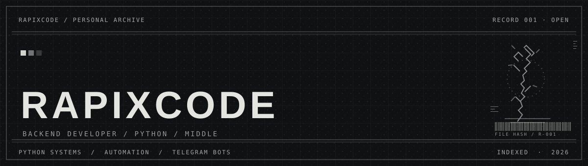

  

  <code>PERSONAL RECORD&nbsp; / &nbsp;NO. 001&nbsp; / &nbsp;PYTHON SYSTEMS</code>

---

### 01 / DOSSIER

Backend-разработчик на Python · Middle · 2 года опыта.

Пишу Telegram-ботов, парсеры и инструменты автоматизации для игровых сообществ. Основной проект — **Blessware**, платформа удалённой автоматизации для GTA 5 Role Play.

### 02 / TOOLCHAIN

`PYTHON` &nbsp; `GIT` &nbsp; `POSTGRESQL` &nbsp; `MYSQL` &nbsp; `REST API`

### 03 / PROJECT INDEX

| FILE | PROJECT | ARCHIVE NOTE |
|:---:|---|---|
| `01` | [**Blessware**](https://github.com/rapixcode/blessware) | Telegram-remote automation for GTA 5 RP |
| `02` | [**CoC-checker**](https://github.com/rapixcode/CoC-checker) | Telegram bot for Clash of Clans stats |
| `03` | [**Party-For-Boost-tgBot**](https://github.com/rapixcode/Party-For-Boost-tgBot) | Dota 2 booster community bot |
| `04` | [**Trilogy-Tools**](https://github.com/rapixcode/Trilogy-Tools-arizonarp-) | Tools for Arizona RP |
| `05` | [**xsoft-ahk**](https://github.com/rapixcode/xsoft-ahk) | Automation utilities |

### 04 / SIGNAL

[`@rapixdoto` — Telegram](https://t.me/rapixdoto) &nbsp;·&nbsp; [GitHub](https://github.com/rapixcode)

  <code>код — это инструмент&nbsp; / &nbsp;END OF RECORD</code>

